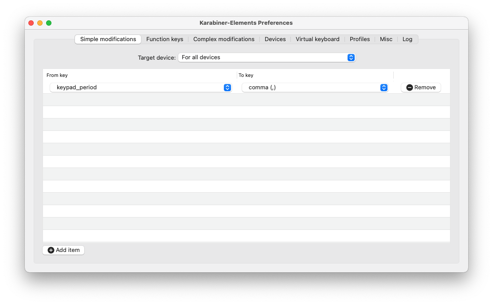
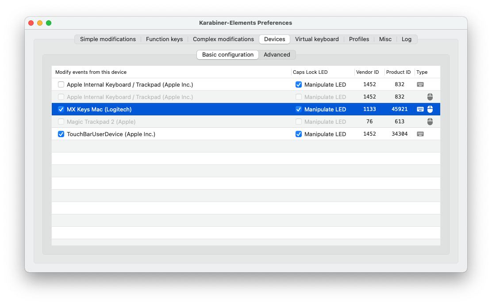

# Machine Setup

My personal collection of configuration files.

## Install [homebrew](https://brew.sh/)

```bash
/bin/bash -c "$(curl -fsSL https://raw.githubusercontent.com/Homebrew/install/HEAD/install.sh)"
```

## Install all other applications with homebrew

```bash
brew bundle --file Brewfile
```

## Configure tools

### Command line

```bash
# Install Oh My ZSH
sh -c "$(curl -fsSL https://raw.githubusercontent.com/ohmyzsh/ohmyzsh/master/tools/install.sh)"

# Copy config
cp .zsh™rc ~
```

Open Shell to install the correct font. (All other settings will be overwritten later.) If it doesn't ask you for a font, you can run

```bash
p10k configure
```

Copy the Powerlevel10k config over

```bash
cp .p10k.zsh ~
```

When using Visual Studio Code, add the following settings to enable the correct styling in your Terminal:

```json
"terminal.integrated.fontFamily": "MesloLGS NF",
```

### Xcode

Needs to be started once to accept the license.

### Android Studio

Needs to be started once to install and configure the Android SDK tools

### Karabiner-Elements





### iTerm

Allow Option + Arrow

### Spotlight

To increase performance and reduce battery drain, remove the folder where you store the source code from Spotlight indexing.


## What needs to be installed manually

- [Global Protect](https://microsoft.sharepoint.com/sites/Network_Connectivity/SitePages/RemoteAccess/GlobalProtect-Desktop-VPN-app-for-Mac.aspx)
- [Audacity](https://www.audacityteam.org/)
