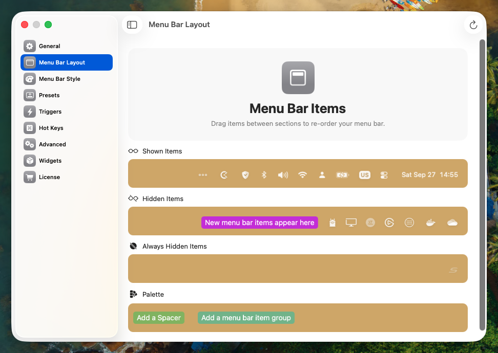
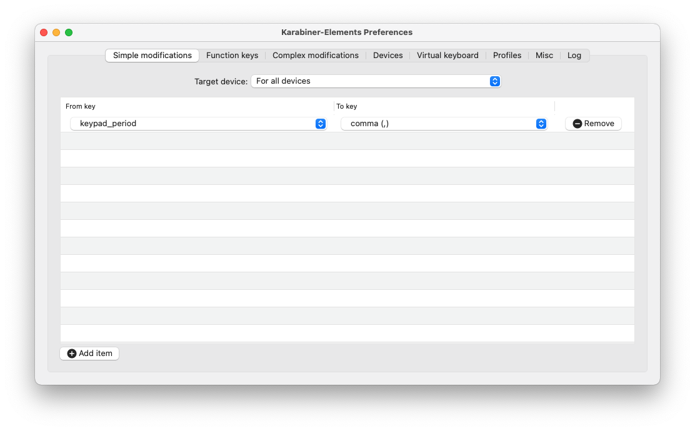
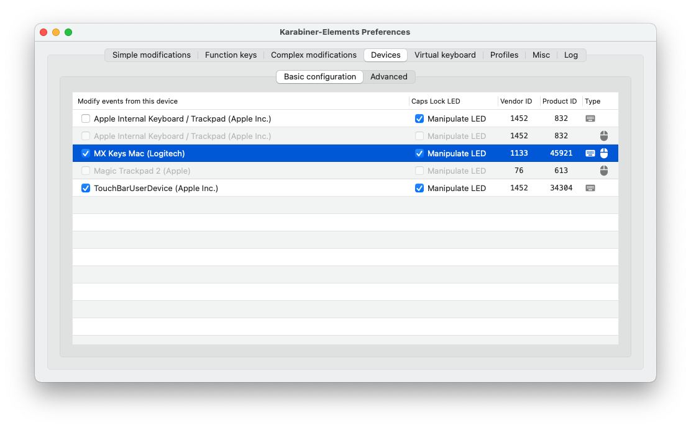

# macOS Settings

- Disable Keyboard Shortcuts for Spotlight
- Disable Keyboard Shortcuts for Screenshots
- Finder: Hide Tags
- Finder: Keep folders on top when sorting by name
- Accessibility: Zoom with Modifier Key Scroll Gesture (Control)
- Desktop: Don't show desktop on click
- Menu Bar: Hide Siri
- Menu Bar: Hide Spotlight
- Menu Bar: Show Bluetooth
- Menu Bar: Always Show Sound
- Dock: Show suggested and recent apps: Disabled
- Add Internet Accounts to System Settings
- Touchpad: Gestures -> App Exposé: 3 Finger Swipe Down

## Bitwarden

- Unlock with Touch ID: Enabled
- Ask for Touch ID on app start: Enabled

## Logi Options+9

- Mouse Middle Button: Custom Gestures
- Mouse Scroll Direction: Standard

## Raycast

- Import Raycast Backup
- Snippets
  - Expand within words: Enabled
- AI: Custom OpenAI Key
- Windows Management Hotkey Preset: Magnet
- Set Hyper Key

### Snippets

- @@ -> <EMAIL>
- !jtl -> <JTL-EMAIL>
- !me -> <NAME>
- !addr -> <ADDRESS>
- !phone -> <PHONE>
- !today -> <DATE>
- !now -> <DATE_AND_TIME>
- !cal -> <CALENDAR-LINK> 

### Extensions

- Bitwarden
- Obsidian
- Lorem Ipsum
- Clockify
- 2FA Finder
- Ente Auth
- Clean Shot X
- Reclaim
- Deepcast
- Whisper Dictation (Download Small Multi-Lingual Model)
- Todoist
- GitHub

### Shortcuts

- Hyper + V: Clipboard History
- Hyper + T: Microsoft Teams
- Hyper + B: Browser
- Hyper + C: Code
- Hyper + M: Mail
- Hyper + SPACE: Dictation
- CTRL + Option + Space: Emoji & Symbols

### Hotkeys

- `bw` -> Search Bitwarden
- `de` -> Translate with DeepL to German
- `en` -> Translate with DeepL to English
- `it` -> Translate with DeepL to Italian
- `otp` -> Open Ente Auth

### Settings

- 2FA -> Also include Mail
- DeepL -> Set API Key
- DeepL -> Set Tone to informal
- DeepL -> Set Default behavior to show translation

## Browser

- [Readwise Reader](https://chromewebstore.google.com/detail/readwise-highlighter/jjhefcfhmnkfeepcpnilbbkaadhngkbi)
- [Make Social Media Great Again](https://chromewebstore.google.com/detail/make-social-media-great-a/feocoiiokphjecgcogdkolkpjjjfgalb?hl=en-US)
- [Notion Web Clipper](https://chromewebstore.google.com/detail/notion-web-clipper/knheggckgoiihginacbkhaalnibhilkk)
- [Bitwarden Password Manager](https://chromewebstore.google.com/detail/bitwarden-password-manage/nngceckbapebfimnlniiiahkandclblb)
  - Account Security -> Lock: Never
  - Autofill -> Make Bitwarden your Default Password Manager
- [Authenticator App](https://chromewebstore.google.com/detail/authenticator-app/pnbabdldpneocemigmicebglmmfcjccm)
- [Clockify Time Tracker](https://chromewebstore.google.com/detail/clockify-time-tracker/pmjeegjhjdlccodhacdgbgfagbpmccpe)
- [Language Tool](https://chromewebstore.google.com/detail/ai-grammar-checker-paraph/oldceeleldhonbafppcapldpdifcinji)

## Arc

- Automatically Update: true
- Sync Sidebar: true

## Outlook

- Sounds: New Message: Disabled
- Reading: External images: Always
- Reading: Swipes: None
- Notifications: Event Reminder Style: macOS _(might require system restart before visible)_
- My Day : Show My Day in Menu Bar: Disabled
- Fonts: 11pt Size

## Spotify

- Download: Very high
- Streaming: Very high
- Startup: No

## Stream Deck

### Plugins

- https://marketplace.elgato.com/product/obs-studio-35615969-830f-45c9-ba0a-1a295bba7fec
- https://marketplace.elgato.com/product/control-center-39a4fa43-1afe-457a-8a19-b5d386e77d53
- https://marketplace.elgato.com/product/audio-mute-705c5433-1e05-4d8a-844f-b5914b7f642f
- https://marketplace.elgato.com/product/audio-switcher-cf41cd3d-ef80-4122-bef2-7f4fb82fcaac
- https://marketplace.elgato.com/product/wave-link-1baa435a-c623-406d-b53c-53338c6d95d3
- https://marketplace.elgato.com/product/microsoft-teams-da5e2bbc-197c-4afe-8a85-a9941bf52697
- https://marketplace.elgato.com/product/home-assistant-884c8c3e-8477-4ecb-99e0-f3101bbfa0aa
- https://marketplace.elgato.com/product/entypo-854efe00-6c8c-4532-854f-d5a2b3e3acae
- https://marketplace.elgato.com/product/font-awesome-regular-b4def7d0-b531-40b9-bb30-255ebd5c6c66
- https://marketplace.elgato.com/product/clockify-64a23b82-7806-4c4a-85a5-162a03e51544

## Elgato Wave Link

- [Compressor Plugin] (https://marketplace.elgato.com/product/compressor-macos-1ae5ef57-1a14-4d18-b195-6ea8259fbce6)
- DeeGate Plugin

## Ollama

- Download Models
  - `ollama run phi4`
  - `ollama run deepseek-r1`

## SwitchResX

- Activate License
- Launch at Login
- Start Daemon
- Create Display Sets
- Assign Hotkeys to Display Sets for Streamdeck (CTRL + Option + Cmd + 1 .. 3)
  
  

## Bartender

- Start at Login: Enabled
- Click on empty menu bar space: Disabled
- Shope or scroll in Menu Bar: Disabled
- Enable item Indexing: Enabled



## Spotlight

To increase performance and reduce battery drain, remove the folder where you store the source code from Spotlight indexing.


## Visual Studio Code

1. log in to Visual Studio Code with your GitHub Account and enable Settings Sync
2. If not already in the settings, copy the content of `.vscode/settings.json` to the settings JSON, which can be opened with (`CMD+Shift+P` -> `Preferences: Open Settings (JSON)`)
3. If not already in the key bindings, copy the content of `.vscode/keybindings.json` to the keybindings JSON, which can be opened with (`CMD+Shift+P` -> `Preferences: Open Keyboard Shortcuts (JSON)`)
4. Open this repository in Visual Studio code and install the recommended extensions

Add the following settings to enable the correct styling for Powerlevel10k in your Terminal:

```json
"terminal.integrated.fontFamily": "MesloLGS NF",
```

## Android Studio

Needs to be started once to install and configure the Android SDK tools.

## Karabiner-Elements





## iTerm

~~Allow Option + Arrow Keymappings: https://apple.stackexchange.com/a/293988~~

## Github Desktop

Just Drag and Drop Repos from Source Folder

## Microsoft Teams

- Configure Microsoft Teams Notification Settings
- Privacy: Third-party app API: Enabled

## Authenticator

- Auto-Start and Menu Bar Disabled
