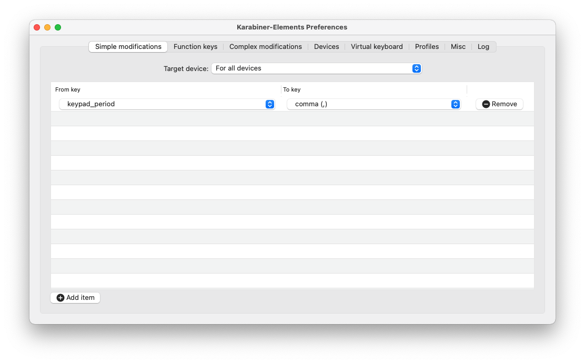
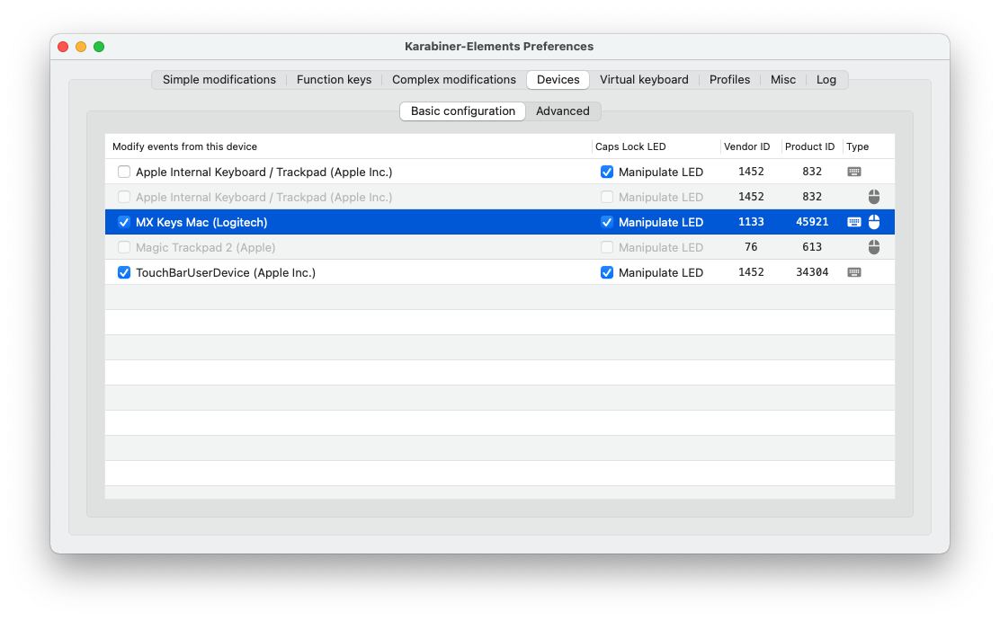

# Setting up a new machine

## Install tools with homebrew

```bash
brew bundle -f Brewfile
```

## Configure tools

### Karabiner-Elements





## What needs to be installed manually

- [Global Protect](https://microsoft.sharepoint.com/sites/Network_Connectivity/SitePages/RemoteAccess/GlobalProtect-Desktop-VPN-app-for-Mac.aspx)
- [Audacity](https://www.audacityteam.org/)

## Configure command line

```bash
# Install Oh My ZSH
sh -c "$(curl -fsSL https://raw.githubusercontent.com/ohmyzsh/ohmyzsh/master/tools/install.sh)"

# Copy config
cp .zshrc ~
```

Open Shell to install the correct font. All other settings will be overwritten later.


```bash
cp .p10k.zsh ~
```
